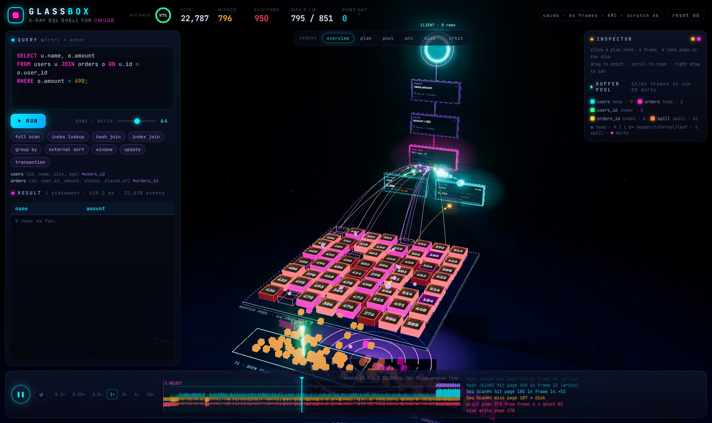
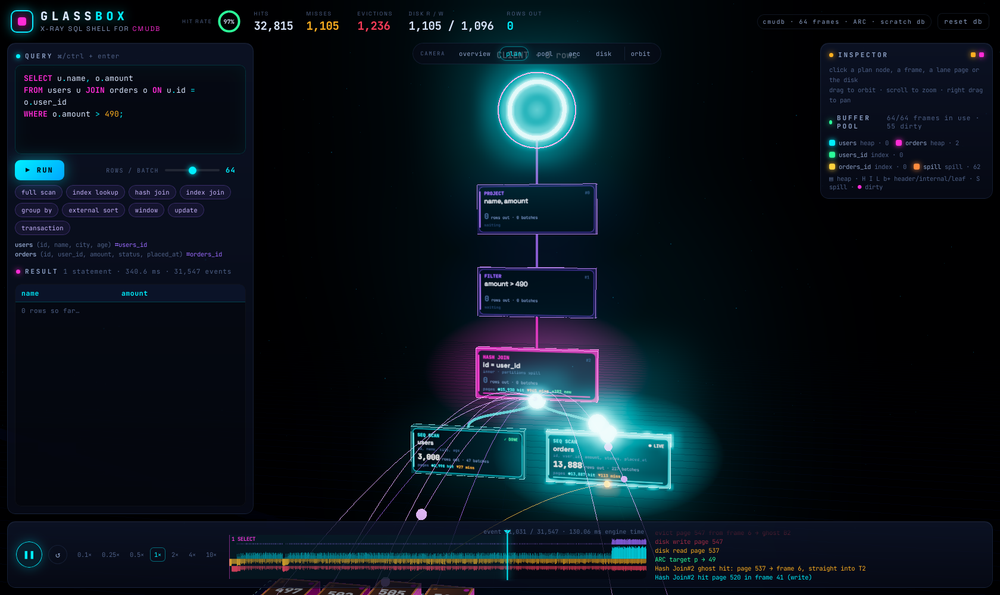
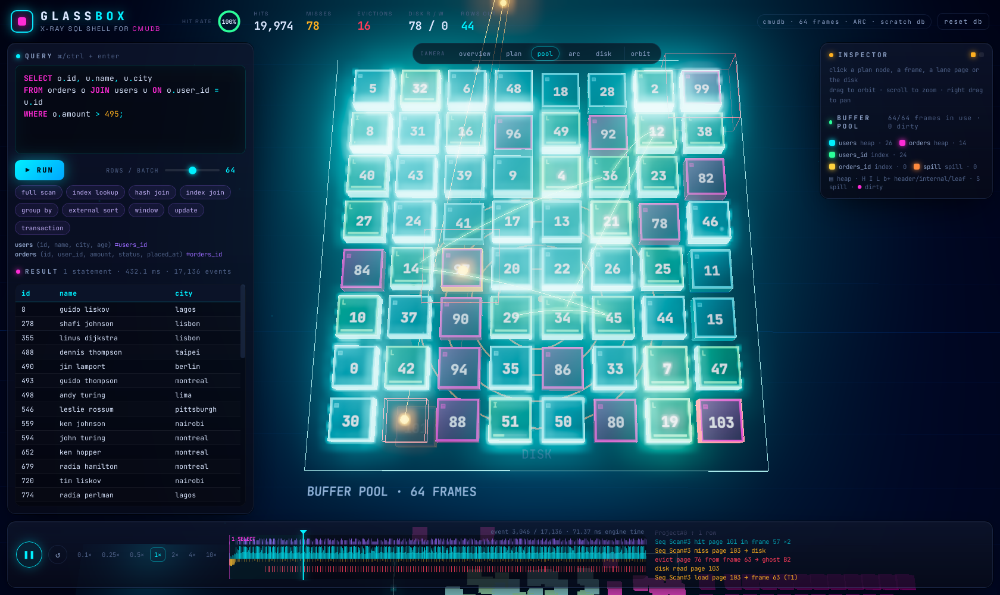

# Glass Box

An x-ray SQL shell for [cmudb](https://github.com/boristopalov/cmudb), as a 3D scene you can
fly around. Type SQL and watch it run: rows stream up the plan tree batch by batch, buffer
pool frames light up on every hit, miss and eviction, pages slide between the ARC
replacer's lists, the disk spins up on reads and writes, and index scans trace their B+ tree
path across the pool.



## Run it

```sh
cargo run --release
```

Then open http://127.0.0.1:7878. It starts a scratch database with demo data (`users`,
3,000 rows, and `orders`, 20,000 rows, each with an index on `id`), and auto-runs a hash join.
Pick an example or write your own SQL, then press ⌘/ctrl + enter.

```
glassbox [--port N] [--frames N] [--sort-budget-kb N] [--empty] [DIR]
  --port N            port to serve on (default 7878)
  --frames N          buffer pool frames (default 64)
  --sort-budget-kb N  ORDER BY memory before it spills sorted runs (default 64)
  --empty             start without the demo tables
  DIR                 open (or create) a database on disk instead of a scratch one
```

The pool is small on purpose, so a scan of `orders` misses and evicts and you can see ARC
adapt. Raise `--frames` to watch the same query turn into hits.

## What you are looking at

Drag to orbit, scroll to zoom, right drag to pan, or jump with the camera buttons
(overview, plan, pool, arc, disk). `orbit` slowly circles the scene. Click anything to see it
in the inspector; hover for a quick label.

- **Plan tree**: each operator is a glass slab floating behind the pool, with live rows,
  batches and page counts on its face. A glowing particle climbs an edge for every batch an
  operator hands its parent, and the root feeds a ring at the top: the client.
- **Buffer pool**: one tile per frame, coloured by owner (table heap, index, sort spill,
  catalog). Pages rise out of the platform when loaded, pulse on hits, and burst red when
  evicted. A beam arcs from the tile to the operator that asked for it, a dot marks dirty
  pages, and the bar on index pages shows how full they are.
- **B+ tree paths**: while an index operator runs, the header, internal and leaf pages it
  walked are linked by a green arc across the pool.
- **ARC replacer**: the lanes in front of the pool. T1 (seen once) and T2 (seen again) share
  the cache box; ghosts in B1 and B2 sit outside it. The green post is ARC's target size p.
- **Disk**: the platter below. Reads fly up to their frame, writes fall back down.
- **Timeline**: the whole run is recorded, then replayed. Drag to scrub, space to pause,
  ←/→ to step, and pick a speed from 0.1× to 10×. The heat strip shows hits, misses and
  evictions over time, and the ticker narrates each event.
- **Statements**: several statements run as one script (try the `transaction` example).
  Each gets a chip with its own result, and an error stops the script there.





## How it works

Glass Box embeds cmudb as a library and changes nothing in it.

- `src/probe.rs` installs a `log` backend and turns cmudb's existing trace lines from the
  buffer pool, ARC replacer, disk manager and B+ tree pages into typed events. It keeps a
  shadow model of the pool (frames, ARC lists, target, page owners) that the tests check
  against the real pool.
- `src/instrument.rs` builds the executor tree itself and wraps every executor, so it knows
  which plan node is running when a page is touched and when each batch moves.
- `src/explain.rs` turns cmudb's plan into the tree the UI draws.
- `src/engine.rs` plans and runs statements, handles `BEGIN`/`COMMIT`/`ROLLBACK`, and records
  each run as a timestamped event trace.
- `src/server.rs` is a small axum server. The UI in `web/` is plain JS modules: `app.js`
  replays the trace and runs the panels, `scene.js` draws the 3D world with three.js.
  three.js is vendored in `web/vendor/three` (MIT, see its LICENSE) and everything is
  compiled into the binary, so there is no build step and three.js never comes from a CDN.

cmudb is pinned through `Cargo.lock`. The probe reads cmudb's log text, so a change to
those messages upstream can break it; `cargo test` catches that.

## Develop

```sh
cargo fmt --check
cargo clippy --all-targets -- -D warnings
cargo test --release
```
